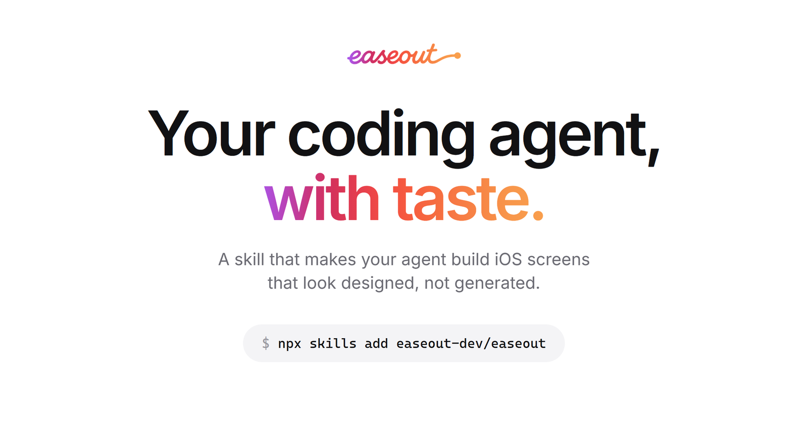
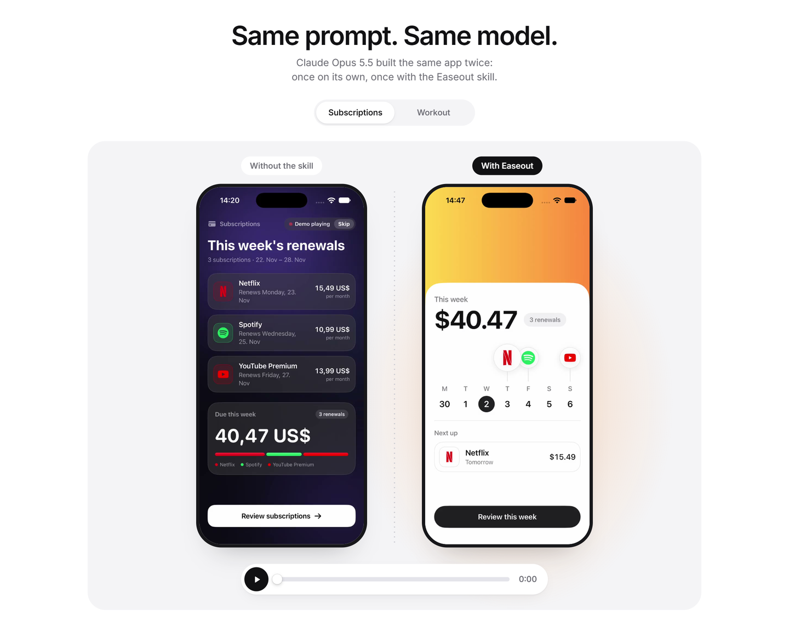

<p align="center">
  
</p>

# Easeout

**A skill that makes your coding agent build iOS screens that look designed, not generated.**

Ask a coding agent for a SwiftUI screen and you often get the same thing: dark gradients, glowing cards, small labels everywhere. Install Easeout once, ask as always, and the screen comes out calm, clear and animated.

## Same prompt. Same model.

Claude Opus 5.5 built the same subscription screen twice: once on its own, once with the Easeout skill.

<p align="center">
  
</p>

See both recordings, and a second test with a workout tracker, on [easeout.dev](https://easeout.dev).

## Install

```bash
npx skills add easeout-dev/easeout
```

Then ask your agent for a screen the way you always do:

> Build a subscriptions screen for my iOS app that shows what renews this week.

The skill loads by itself whenever you ask for an animated or polished SwiftUI screen.

## What the skill does

- **Big and few.** Four or five blocks per screen, one huge number, one simple hero graphic, a lot of white space, one black button.
- **Real logos.** When your data names a real company, the agent uses its official logo (from [Simple Icons](https://simpleicons.org)) in a white circle, never a coloured letter tile.
- **Motion that feels native.** Content arrives piece by piece, numbers roll, screens blur out instead of sliding, buttons answer with black, grey and green states, and everything respects Reduce Motion.
- **Checks before it answers.** The agent counts blocks, compares its screen with the reference screens and runs a checklist.

## Scenes

The skill also carries eight ready-made animated screens. Ask for one by name ("add the Easeout flight scene") or copy its prompt from [easeout.dev/scenes](https://easeout.dev/scenes/).

| Scene | What moves |
|---|---|
| Flight status | A plane flies its route |
| Voice note | A waveform grows as you talk |
| Split the bill | A ring chart fills itself |
| Portfolio chart | A line chart you can scrub |
| Weather | A sun you drag across the sky |
| Lift | Plates slide onto a barbell |
| Subscriptions | Logos pinned to the days they renew |
| Workout | A timer and heart rate that stay calm |

Every scene is SwiftUI only, iOS 17 or later, with no packages.

## What is in this repository

```
skills/easeout/
  SKILL.md                      what the agent reads first
  references/motion-system.md   the motion kit: curves, springs, reveals, the button
  references/screen-layout.md   the layout: big and few, logos, the four screen patterns
  references/checklist.md       what the agent checks before it answers
  references/examples/          one complete screen in the target look
  references/screens/           reference screenshots
  scenes/                       the eight ready-made scenes
```

## License

[MIT](LICENSE). Brand logos shown in the examples belong to their owners and are used only to show how real logos look in a screen; Easeout is not affiliated with them.

Made by [Roman Grosz](https://romangrosz.com).
